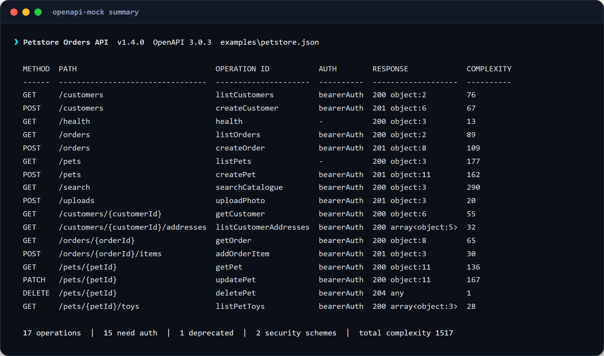
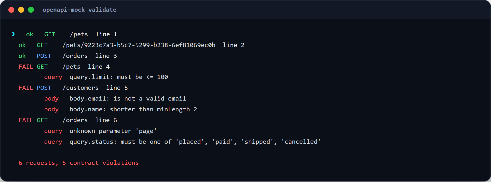
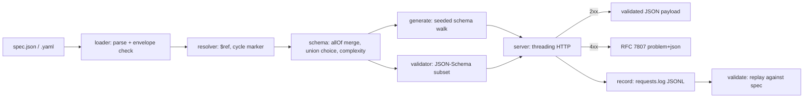

# openapi-mock

Turn any OpenAPI 3 document into a running, contract-valid, deterministic mock API — with one command, zero dependencies, and request validation that tells you exactly which field is wrong.



[](https://github.com/kele-tao/openapi-mock/actions/workflows/ci.yml)


---

## The problem

A frontend team cannot start until the backend ships. So someone hand-writes a
mock: twenty JSON fixtures, a tiny Express server, and a week later those fixtures
have drifted from the spec, return fields that no longer exist, and answer 200 for
requests the real API would reject with 422. The mock becomes a second, wrong
source of truth — and the bugs it hides are found in integration instead of on a
laptop.

openapi-mock reads the same OpenAPI document the backend publishes, generates
data that actually satisfies it, and rejects requests that violate it. When the
spec changes, you restart the process. Nothing to maintain, nothing to drift.

```console
$ pip install -e .
$ openapi-mock serve examples/petstore.json --seed 42
openapi-mock  Petstore Orders API v1.4.0
  17 operations from examples\petstore.json
  seed 42
  http://127.0.0.1:8787
    GET    http://127.0.0.1:8787/customers  -> listCustomers
    POST   http://127.0.0.1:8787/customers  -> createCustomer
    GET    http://127.0.0.1:8787/health  -> health
    GET    http://127.0.0.1:8787/orders  -> listOrders
    POST   http://127.0.0.1:8787/orders  -> createOrder
    GET    http://127.0.0.1:8787/pets  -> listPets
    ... 11 more
  ctrl-c to stop
```

## What it does

- **Loads OpenAPI 3.0 and 3.1** from JSON, and from YAML when `PyYAML` is installed
  (`pip install -e ".[yaml]"`). Swagger 2.0, a missing `openapi` field, or an
  HTML error page gives a one-line error with a hint, never a traceback.
- **Resolves `$ref`** — local pointers and relative files
  (`./common.json#/Address`) — with cycle detection, so a recursive schema
  terminates instead of hanging. Remote refs are refused explicitly: this tool is
  offline by design.
- **Merges `allOf`** (properties, required, bounds, enums) and **selects
  `oneOf`/`anyOf`** branches by structure, so a union's object arm gets served,
  not always its string arm.
- **Generates data that validates.** Formats (date, date-time, uuid, email, uri,
  ipv4, ipv6, byte, hostname, password), `enum`, `const`, `pattern`,
  numeric and length bounds, `multipleOf`, arrays with `minItems`,
  `additionalProperties`. A test asserts every generated payload validates.
- **Looks like production data.** Field names drive realistic pools: `city` is a
  city, `sku` is `SKU-B4821`, `name` inside `Pet` is a pet name while
  inside `Customer` it is a person's name. Realism is checked against the
  schema, so it never wins over validity.
- **Validates requests** — path, query, header and JSON body — and answers
  `422 application/problem+json` (RFC 7807) listing every violation at once.
- **Injects the boring reality**: `--latency 50`, `--error-rate 0.1`,
  `--cors`, `--stateful` (POST then GET returns what you created),
  `--record` (append every request to a JSONL log).
- **Replays a request log** with `validate`, so the mock doubles as a test double for
  a client: it tells you which of your calls the real API would reject.
- **Summarises a spec**: endpoint table with operation ids, auth schemes,
  deprecation flags and a complexity score per endpoint.

## Install

Not on PyPI yet — install from source:

```bash
git clone https://github.com/kele-tao/openapi-mock.git
cd openapi-mock
pip install -e .            # the tool itself: zero runtime dependencies
pip install -e ".[yaml]"    # plus PyYAML, to load .yaml specs
pip install -e ".[dev]"     # plus pytest and ruff, to hack on it
```

Requires Python 3.10+. Everything is stdlib; PyYAML is the only optional dependency
and it is imported lazily, so a JSON-only install genuinely has no dependencies.

## Usage

### 1. Look at a spec before you serve it

```console
$ openapi-mock summary examples/petstore.json
Petstore Orders API  v1.4.0  OpenAPI 3.0.3  examples/petstore.json

  METHOD  PATH                               OPERATION ID           AUTH        RESPONSE             COMPLEXITY
  ------  ---------------------------------  ---------------------  ----------  -------------------  ----------
  GET     /customers                         listCustomers          bearerAuth  200 object:2         76
  POST    /customers                         createCustomer         bearerAuth  201 object:6         67
  GET     /health                            health                 -           200 object:3         13
  GET     /orders                            listOrders             bearerAuth  200 object:2         89
  POST    /orders                            createOrder           bearerAuth  201 object:8         109
  GET     /pets                              listPets               -           200 object:3         177
  POST    /pets                              createPet             bearerAuth  201 object:11        162
  GET     /search                            searchCatalogue        bearerAuth  200 object:3         290
  POST    /uploads                           uploadPhoto            bearerAuth  201 object:3         20
  GET     /customers/{customerId}            getCustomer            bearerAuth  200 object:6         55
  GET     /customers/{customerId}/addresses  listCustomerAddresses  bearerAuth  200 array<object:5>  32
  GET     /orders/{orderId}                  getOrder               bearerAuth  200 object:8         65
  POST    /orders/{orderId}/items            addOrderItem           bearerAuth  201 object:3         30
  GET     /pets/{petId}                      getPet                 bearerAuth  200 object:11        136
  PATCH   /pets/{petId}                      updatePet              bearerAuth  200 object:11        167
  DELETE  /pets/{petId}                      deletePet              bearerAuth  204 any              1
  GET     /pets/{petId}/toys                 listPetToys            bearerAuth  200 array<object:3>  28

  17 operations  |  15 need auth  |  1 deprecated  |  2 security schemes  |  total complexity 1517
```

`--json` gives the same data as machine-readable JSON. `--fail-on-deprecated`
exits 1 when the spec carries deprecated endpoints, which is what you want in CI.

### 2. Serve it and curl it

```console
$ openapi-mock serve examples/petstore.json --port 0 --print-url --seed 42 --quiet
http://127.0.0.1:50315
```

The first line is the bound URL — `--port 0` lets the OS pick a free port, which is
how the test suite starts a server without racing other processes. Then:

```console
$ curl -s "http://127.0.0.1:50315/pets/9f3c1c4e-0d1b-4c9e-9d8a-7f6e5d4c3b2a" | python -m json.tool
{
    "id": "9f3c1c4e-0d1b-4c9e-9d8a-7f6e5d4c3b2a",
    "name": "Gentle Mochi",
    "sku": "PET-ZA-0123",
    "status": "sold",
    "category": {
        "id": 976,
        "name": "Sleepy Pepper"
    },
    "tags": [
        "eco",
        "limited",
        "eco",
        "pro"
    ],
    "weightKg": 77.53,
    "vaccinated": false,
    "photoUrl": "https://harbor.example.com/falcon/542",
    "createdAt": "2025-12-10T13:28:54Z",
    "owner": {
        "id": "3e12f6dc-37d3-5dc3-a0fa-4116da1704ed",
        "email": "alan.turing@example.com",
        "name": "Smoky Clementine",
        "phone": "+351 962801287",
        "marketingOptIn": true,
        "addresses": [
            {
                "line1": "44 Harbour Road",
                "line2": "bravo alpha",
                "city": "Ljubljana",
                "country": "CA"
            },
            {
                "line1": "44 Harbour Road",
                "line2": "indigo ember",
                "city": "Gdansk",
                "postalCode": "8062-611",
                "country": "NO"
            }
        ]
    }
}```

The `id` matches the path because the server echoes the path identifier back when
the response schema allows it, so a client fetch returns the object it asked for. The
same request with `--seed 42` returns byte-identical JSON on every run and on every
machine — that is what makes snapshot tests possible. Now ask for something the spec
forbids:

```console
$ curl -s -i "http://127.0.0.1:50315/pets?limit=500"
HTTP/1.1 422 Unprocessable Entity
Content-Type: application/problem+json; charset=utf-8

{"type": "https://openapi-mock.dev/problems/unprocessable-entity", "title": "Unprocessable Entity",
 "status": 422, "detail": "request does not satisfy listPets", "instance": "/pets",
 "errors": [{"location": "query", "detail": "query.limit: must be <= 100"}]}
```

`limit` is declared `maximum: 100`; the mock refuses to pretend otherwise. Every
violation is reported, not just the first. (Response headers other than
`Content-Type` are omitted above for width.)

### 3. Turn the mock into a test double for your client

`--record` writes one JSON object per request. `validate` replays that log against
the spec and reports what the *client* got wrong:

```console
$ openapi-mock validate --requests examples/requests.log --spec examples/petstore.json
  ok   GET    /pets  line 1
  ok   GET    /pets/9223c7a3-b5c7-5299-b238-6ef81069ec0b  line 2
  ok   POST   /orders  line 3
  FAIL GET    /pets  line 4
         query  query.limit: must be <= 100
  FAIL POST   /customers  line 5
         body   body.email: is not a valid email
         body   body.name: shorter than minLength 2
  FAIL GET    /orders  line 6
         query  unknown parameter 'page'
         query  query.status: must be one of 'placed', 'paid', 'shipped', 'cancelled'

  6 requests, 5 contract violations
```



Exit code 1 when anything is wrong, so it drops straight into CI.
`examples/requests.log` is a hand-written fixture in exactly the JSONL format
`--record` emits (one object per line, `method`, `path`, `query`, `headers`,
optional `body` and `status`); three of its six lines are valid and three are not,
by construction.

### 4. Print one payload (for fixtures)

```console
$ openapi-mock sample examples/petstore.json --operation getOrder --seed 42
{
  "id": "8a32a46b-16d7-50d3-beb7-443e4abd4d7d",
  "petId": "a6121286-594a-5ab6-987a-1bc5cbcff383",
  "quantity": 18,
  "total": { "amount": 865.24, "currency": "JPY" },
  "status": "paid",
  "placedAt": "2025-12-07T13:28:45Z",
  "shipTo": { "line1": "44 Harbour Road", "city": "Ghent", "country": "PL" }
}
```

## How it works



The **loader** parses the document and rejects the envelope early, then inlines
every `$ref` with a stack of visited references so recursive schemas terminate.
Path resolution is memoised — on Windows one `realpath` call costs ~0.8 ms, and
caching it took spec load from 111 ms to 8 ms on the bundled example.

The **schema layer** flattens `allOf` by overlaying branches (bounds intersect,
required unions) and scores complexity; `oneOf`/`anyOf` branches are picked by
score so the richest shape is served. The **generator** walks the schema with a
`random.Random` seeded by `crc32(seed, depth, field, call index)`: same seed, same
bytes, while fields still vary from each other. The **validator** shares that schema
interpretation, so generation and validation cannot disagree — a test feeds every
generated payload back through the validator.

The **server** is `ThreadingHTTPServer` and nothing else. Routing is a linear scan
over pre-sorted operations; every request is validated with the same code path
`validate` uses on a log, which is why live 422s and replayed findings always agree.

## Design decisions

**1. Stdlib only, at the cost of throughput.** A framework would give us async and
higher throughput we do not need; a mock serves one developer's browser tab. Zero
runtime dependencies means `pip install` cannot fail behind a corporate proxy and
the whole tool reads in an afternoon. Measured cost: ~3 ms p50 per request on this
laptop (see below) — invisible next to typing a URL.

**2. Determinism over variety.** Every response is a pure function of
`(spec, seed, operation)`. We could shuffle data per call to look "real", but
then snapshot tests and screenshot diffs break. `--seed` is the whole contract;
`X-Mock-Seed` is echoed on every response so a failing test can reproduce it.

**3. Reject, do not repair.** When a client sends `limit=500` against
`maximum: 100`, the mock returns 422 rather than clamping. Clamping feels helpful
and is exactly how mocks hide bugs. The one place we do repair is the *response*:
`readOnly` fields and the addressed id are filled so a GET returns something
believable.

**4. Validation is a subset, and says so.** `not`, `if`/`then`/`else` and
`discriminator` are reported as notes in `summary` and ignored by validation,
rather than half-implemented. Patterns outside the synthesisable subset fall back to
schema-typed values instead of pretending to match.

## Performance

Produced by `python benchmarks/run.py` on Python 3.12.10 / Windows, serving the
bundled 17-operation spec over loopback. `benchmarks/results.json` is committed
alongside this table so you can diff it.

| Metric | Value |
| --- | --- |
| Spec load (17 operations, median of 20 runs) | 8.08 ms |
| Single endpoint, keep-alive (p50 / p95) | 3.23 / 12.17 ms |
| Templated route `/pets/{petId}` (p50 / p95) | 5.11 / 14.49 ms |
| Mixed endpoints, keep-alive (p50 / p95) | 5.11 / 13.79 ms |
| Replay check per request | 28.1 us |
| Payload generation per response | 1.049 ms |
| Requests measured in mixed run | 180 |

Numbers move a little between runs of the harness; the shape does not. Loading a
17-operation spec is single-digit milliseconds, a response is a few milliseconds,
and replaying a request log costs microseconds per line.

## Comparison

| | openapi-mock | Prism (Stoplight) | Mockoon | WireMock |
| --- | --- | --- | --- | --- |
| Install | `pip install -e .`, 0 runtime deps | Node, large tree | Desktop app | JVM |
| Deterministic seed | yes, byte-identical | no | no | partial |
| Request validation -> RFC 7807 | yes, all violations | yes | limited | yes |
| Replay a request log as a contract check | yes (`validate`) | no | no | no |
| Endpoint table with complexity score | yes | no | no | no |
| Record mode + JSONL log | yes | no | partial | yes |
| GUI | no | partial | yes | no |
| Dynamic `$ref` to other files, cycles | yes | yes | yes | yes |
| Proxy/record against a real API | no | yes | yes | yes |

Prism and Mockoon are more mature and do things we do not (proxying real traffic,
GUIs, request matching DSLs). WireMock has a far richer stateful model. openapi-mock
trades those for a zero-dependency install, deterministic output, and one command
that both serves and audits.

## Roadmap

- `--store path.json` so `--stateful` survives a restart.
- Enforce `apiKey`/`bearer` schemes behind an opt-in flag.
- `--watch spec.json` hot reload without dropping the port.
- Per-endpoint status overrides for testing error states.
- Larger JSON-Schema subset (`not`, `if`/`then`, `discriminator`).

Deliberate v1.0 omissions (auth enforcement, multipart validation, response headers,
persistence) are documented in [docs/ROADMAP.md](docs/ROADMAP.md).
Architecture is in [docs/ARCHITECTURE.md](docs/ARCHITECTURE.md); every flag and exit
code is documented in [docs/CLI.md](docs/CLI.md).

## Exit codes

| Code | Meaning |
| --- | --- |
| 0 | success, nothing to report |
| 1 | findings: deprecated endpoints (`--fail-on-deprecated`) or contract violations |
| 2 | usage error: unreadable spec, bad flag value, malformed log, port in use |

## Development

```bash
pip install -e ".[dev]"
pytest -q                  # 139 tests, no network, ~5 s
ruff check .               # clean at line length 100
python benchmarks/run.py   # regenerates benchmarks/results.json
```

`pytest` also runs straight from a checkout without installing (the suite adds
`src` to `sys.path` via `pyproject.toml`), which is handy when you only want to
check a change.

Layout: `src/openapi_mock` (implementation), `tests` (pytest),
`examples` (the petstore spec and a sample request log), `benchmarks`
(the only source of the numbers above), `docs` (screenshot, architecture,
CLI reference, roadmap).

`docs/screenshot.png` is a real terminal capture of
`python -m openapi_mock summary examples/petstore.json` — re-run that command and
you get the same table in your own shell.

## Contributing

Issues and PRs welcome. Run `pytest -q` and `ruff check .` before opening a PR;
new behaviour needs a test that asserts it, and any number in the README needs a
command in this repo that reproduces it. See [CONTRIBUTING.md](CONTRIBUTING.md).

## License

MIT — see [LICENSE](LICENSE). Copyright (c) 2026 kele.