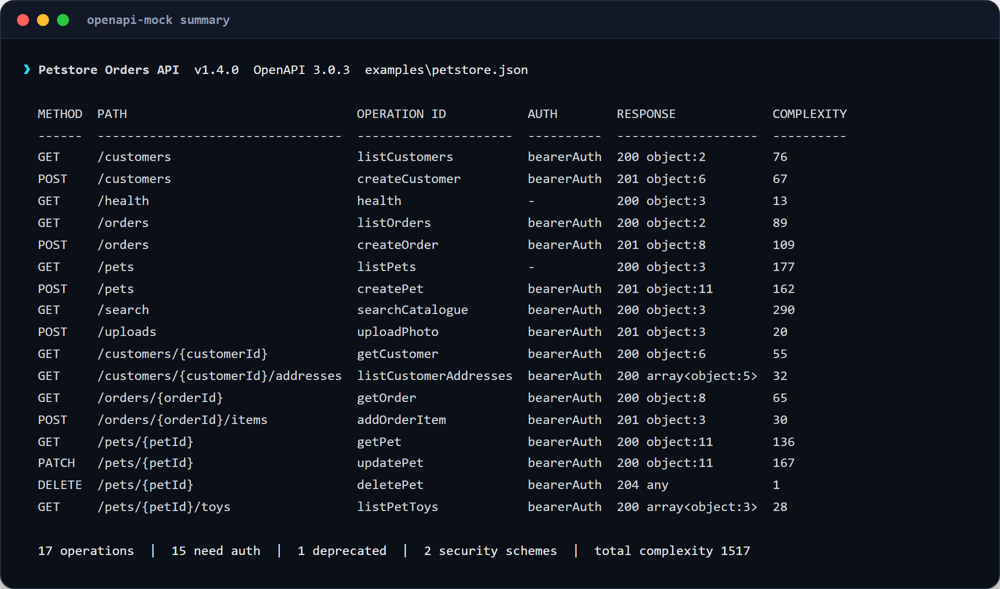
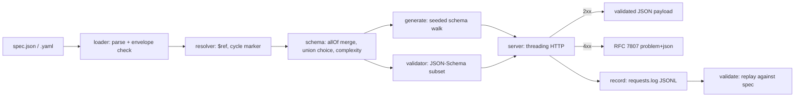

# openapi-mock

[English](README.md) | **简体中文**

把任何一份 OpenAPI 3 文档变成一个正在运行、符合契约（contract）、结果确定的 mock API —— 一条命令、零依赖，
而且请求校验会明确告诉你究竟是哪个字段错了。



[](https://github.com/kele-tao/openapi-mock/actions/workflows/ci.yml)


---

## 问题

后端迟迟不上线，前端团队就没法开工。于是有人手写一个 mock：二十份 JSON 样例数据、一个几十行的
Express 服务；一周之后，这些数据和 spec 已经脱节，返回的是早就不存在的字段，对真实 API 会以
422 拒绝的请求照样回 200。mock 于是变成第二个真相来源，而且是个错的 —— 它掩盖的 bug 要等到
联调时才被发现，而不是在自己笔记本上。

openapi-mock 读取后端发布的那同一份 OpenAPI 文档，生成真正满足它的数据，并拒绝违反它的请求。
spec 变了，重启进程即可。没有东西需要维护，也没有东西会漂移。

```console
$ pip install -e .
$ openapi-mock serve examples/petstore.json --seed 42
openapi-mock  Petstore Orders API v1.4.0
  17 operations from examples\petstore.json
  seed 42
  http://127.0.0.1:8787
    GET    http://127.0.0.1:8787/customers  -> listCustomers
    POST   http://127.0.0.1:8787/customers  -> createCustomer
    GET    http://127.0.0.1:8787/health  -> health
    GET    http://127.0.0.1:8787/orders  -> listOrders
    POST   http://127.0.0.1:8787/orders  -> createOrder
    GET    http://127.0.0.1:8787/pets  -> listPets
    ... 11 more
  ctrl-c to stop
```

## 它能做什么

- **加载 OpenAPI 3.0 与 3.1**：从 JSON 加载；安装了 `PyYAML` 时也从 YAML 加载
  （`pip install -e ".[yaml]"`）。Swagger 2.0、缺少 `openapi` 字段、或者下载到一张
  HTML 错误页，都会给出一行带提示的错误，而不是抛出 traceback。
- **解析 `$ref`** —— 本地指针和相对文件
  （`./common.json#/Address`）—— 并带循环检测，所以递归 schema 会终止而不是挂死。远程引用
  被明确拒绝：这个工具在设计上就是离线的。
- **合并 `allOf`**（properties、required、边界、枚举），并**按结构挑选
  `oneOf`/`anyOf`** 分支，所以联合类型给出的会是对象分支，
  而不是永远只有字符串分支。
- **生成能通过校验的数据。** 各种 format（date、date-time、uuid、email、uri、
  ipv4、ipv6、byte、hostname、password）、`enum`、`const`、`pattern`、
  数值与长度边界、`multipleOf`、带 `minItems` 的数组、
  `additionalProperties`。有一个测试断言每一份生成的 payload 都能通过校验。
- **看起来像生产数据。** 字段名驱动真实感词库：`city` 给城市，`sku` 给
  `SKU-B4821`，`Pet` 里的 `name` 是宠物名，而
  `Customer` 里的 `name` 是人名。真实感要接受
  schema 的检查，所以它永远不会压过合法性。
- **校验请求** —— path、query、header 和 JSON body —— 返回
  `422 application/problem+json`（RFC 7807），一次性列出所有违规。
- **注入那些无聊的现实**：`--latency 50`、`--error-rate 0.1`、
  `--cors`、`--stateful`（POST 之后 GET 返回你刚创建的东西）、
  `--record`（把每个请求追加写进 JSONL 日志）。
- **重放请求日志**，用 `validate`，于是这份 mock 同时充当客户端的测试替身：
  它告诉你哪些调用真实 API 会拒绝。
- **给一份 spec 出摘要**：带 operation id、认证方案、
  弃用标记和每个端点复杂度评分的端点表格。

## 安装

还没上 PyPI —— 从源码安装：

```bash
git clone https://github.com/kele-tao/openapi-mock.git
cd openapi-mock
pip install -e .            # the tool itself: zero runtime dependencies
pip install -e ".[yaml]"    # plus PyYAML, to load .yaml specs
pip install -e ".[dev]"     # plus pytest and ruff, to hack on it
```

需要 Python 3.10+。全部用标准库；PyYAML 是唯一的可选依赖，而且是惰性导入的，
所以只处理 JSON 的安装确实零依赖。

## 用法

### 1. 在把它跑起来之前，先看一眼 spec

```console
$ openapi-mock summary examples/petstore.json
Petstore Orders API  v1.4.0  OpenAPI 3.0.3  examples/petstore.json

  METHOD  PATH                               OPERATION ID           AUTH        RESPONSE             COMPLEXITY
  ------  ---------------------------------  ---------------------  ----------  -------------------  ----------
  GET     /customers                         listCustomers          bearerAuth  200 object:2         76
  POST    /customers                         createCustomer         bearerAuth  201 object:6         67
  GET     /health                            health                 -           200 object:3         13
  GET     /orders                            listOrders             bearerAuth  200 object:2         89
  POST    /orders                            createOrder           bearerAuth  201 object:8         109
  GET     /pets                              listPets               -           200 object:3         177
  POST    /pets                              createPet             bearerAuth  201 object:11        162
  GET     /search                            searchCatalogue        bearerAuth  200 object:3         290
  POST    /uploads                           uploadPhoto            bearerAuth  201 object:3         20
  GET     /customers/{customerId}            getCustomer            bearerAuth  200 object:6         55
  GET     /customers/{customerId}/addresses  listCustomerAddresses  bearerAuth  200 array<object:5>  32
  GET     /orders/{orderId}                  getOrder               bearerAuth  200 object:8         65
  POST    /orders/{orderId}/items            addOrderItem           bearerAuth  201 object:3         30
  GET     /pets/{petId}                      getPet                 bearerAuth  200 object:11        136
  PATCH   /pets/{petId}                      updatePet              bearerAuth  200 object:11        167
  DELETE  /pets/{petId}                      deletePet              bearerAuth  204 any              1
  GET     /pets/{petId}/toys                 listPetToys            bearerAuth  200 array<object:3>  28

  17 operations  |  15 need auth  |  1 deprecated  |  2 security schemes  |  total complexity 1517
```

`--json` 以机器可读的 JSON 给出同样的数据。`--fail-on-deprecated`
在 spec 带有弃用端点时以 1 退出，这正是你在 CI 里想要的。

### 2. 把它跑起来，然后 curl

```console
$ openapi-mock serve examples/petstore.json --port 0 --print-url --seed 42 --quiet
http://127.0.0.1:50315
```

第一行是绑定后的 URL —— `--port 0` 让操作系统挑一个空闲端口，测试套件正是这样
启动服务器而不去和其他进程抢端口。然后：

```console
$ curl -s "http://127.0.0.1:50315/pets/9f3c1c4e-0d1b-4c9e-9d8a-7f6e5d4c3b2a" | python -m json.tool
{
    "id": "9f3c1c4e-0d1b-4c9e-9d8a-7f6e5d4c3b2a",
    "name": "Gentle Mochi",
    "sku": "PET-ZA-0123",
    "status": "sold",
    "category": {
        "id": 976,
        "name": "Sleepy Pepper"
    },
    "tags": [
        "eco",
        "limited",
        "eco",
        "pro"
    ],
    "weightKg": 77.53,
    "vaccinated": false,
    "photoUrl": "https://harbor.example.com/falcon/542",
    "createdAt": "2025-12-10T13:28:54Z",
    "owner": {
        "id": "3e12f6dc-37d3-5dc3-a0fa-4116da1704ed",
        "email": "alan.turing@example.com",
        "name": "Smoky Clementine",
        "phone": "+351 962801287",
        "marketingOptIn": true,
        "addresses": [
            {
                "line1": "44 Harbour Road",
                "line2": "bravo alpha",
                "city": "Ljubljana",
                "country": "CA"
            },
            {
                "line1": "44 Harbour Road",
                "line2": "indigo ember",
                "city": "Gdansk",
                "postalCode": "8062-611",
                "country": "NO"
            }
        ]
    }
}```

`id` 与路径一致，因为当响应 schema 允许时，服务器会把路径里的标识符回显回去，
于是客户端请求到的正是它要的那个对象。同一个请求加上 `--seed 42`，每次运行、每台机器
返回的 JSON 都按字节完全相同 —— 这才让快照测试成为可能。现在去请求一个 spec
禁止的东西：

```console
$ curl -s -i "http://127.0.0.1:50315/pets?limit=500"
HTTP/1.1 422 Unprocessable Entity
Content-Type: application/problem+json; charset=utf-8

{"type": "https://openapi-mock.dev/problems/unprocessable-entity", "title": "Unprocessable Entity",
 "status": 422, "detail": "request does not satisfy listPets", "instance": "/pets",
 "errors": [{"location": "query", "detail": "query.limit: must be <= 100"}]}
```

`limit` 声明为 `maximum: 100`；mock 拒绝假装不是。所有违规都会被报告，
而不只是第一条。（为了宽度，上面省略了 `Content-Type` 之外的响应头。）

### 3. 把 mock 变成你客户端的测试替身

`--record` 每个请求写一个 JSON 对象。`validate` 把这份日志对着
spec 重放，报告*客户端*做错了什么：

```console
$ openapi-mock validate --requests examples/requests.log --spec examples/petstore.json
  ok   GET    /pets  line 1
  ok   GET    /pets/9223c7a3-b5c7-5299-b238-6ef81069ec0b  line 2
  ok   POST   /orders  line 3
  FAIL GET    /pets  line 4
         query  query.limit: must be <= 100
  FAIL POST   /customers  line 5
         body   body.email: is not a valid email
         body   body.name: shorter than minLength 2
  FAIL GET    /orders  line 6
         query  unknown parameter 'page'
         query  query.status: must be one of 'placed', 'paid', 'shipped', 'cancelled'

  6 requests, 5 contract violations
```

有错时退出码为 1，所以它能直接塞进 CI。
`examples/requests.log` 是一份手写的样例文件，格式正是 `--record` 输出的 JSONL
（一行一个对象，`method`、`path`、`query`、`headers`，
可选的 `body` 和 `status`）；六行里有三行合法、三行不合法，
这是刻意构造的。

### 4. 打印一段 payload（用于样例数据）

```console
$ openapi-mock sample examples/petstore.json --operation getOrder --seed 42
{
  "id": "8a32a46b-16d7-50d3-beb7-443e4abd4d7d",
  "petId": "a6121286-594a-5ab6-987a-1bc5cbcff383",
  "quantity": 18,
  "total": { "amount": 865.24, "currency": "JPY" },
  "status": "paid",
  "placedAt": "2025-12-07T13:28:45Z",
  "shipTo": { "line1": "44 Harbour Road", "city": "Ghent", "country": "PL" }
}
```

## 工作原理



**loader** 解析文档并提前拒绝不合格的外层结构，然后把每一个 `$ref` 内联，用一个记录
已访问引用的栈来保证递归 schema 会终止。路径解析做了记忆化 —— 在 Windows 上一次
`realpath` 调用大约要 0.8 ms，缓存之后，在仓库自带的示例上把 spec 加载从 111 ms
降到 8 ms。

**schema 层**通过叠加分支来展平 `allOf`（边界取交集，required 取并集）并计算复杂度；
`oneOf`/`anyOf` 的分支按评分挑选，从而挑出最丰富的形状来服务。**生成器**用一个
以 `crc32(seed, depth, field, call index)` 播种的 `random.Random` 遍历
schema：同样的 seed、同样的字节，而字段之间仍然彼此不同。**校验器**共用同一套
schema 解释，所以生成和校验不可能互相矛盾 —— 有一个测试把每一份生成的 payload
再喂回校验器。

**服务器**就是 `ThreadingHTTPServer`，再没有别的。路由是对预排序好的操作做线性扫描；
每个请求都走 `validate` 重放日志时用的那条代码路径，这就是为什么线上返回的 422
和重放得到的结论总是一致。

## 设计取舍

**1. 只用标准库，代价是吞吐。** 框架能给我们异步和更高的吞吐，但我们并不需要；
一份 mock 服务的是一个开发者的浏览器标签页。零运行时依赖意味着 `pip install`
不会在公司代理后面失败，而且整个工具一个下午就能读完。实测代价：在这台笔记本上
每个请求 p50 约 3 ms（见下文）—— 相对于敲一个 URL 的时间可以忽略。

**2. 确定性优先于多样性。** 每个响应都是
`(spec, seed, operation)` 的纯函数。我们本可以每次调用都打乱数据，让它看起来“真实”，
但那样快照测试和截图比对就全坏了。`--seed` 就是全部契约；
`X-Mock-Seed` 会回显在每个响应上，这样失败的测试可以据此复现。

**3. 拒绝，而不是修复。** 当客户端对着 `maximum: 100` 发来
`limit=500` 时，mock 返回 422，而不是把它截断到边界内。截断看起来很贴心，
而这恰恰是 mock 掩盖 bug 的方式。唯一会做修复的地方是*响应*：
`readOnly` 字段和被寻址的 id 会被填上，好让一次 GET 返回一个可信的对象。

**4. 校验只是子集，而且如实说明。** `not`、`if`/`then`/`else` 和
`discriminator` 在 `summary` 里以备注形式报告、在校验时被忽略，
而不是做成半吊子实现。合成不出值的模式会退回到 schema 类型的值，
而不是假装匹配成功。

## 性能与基准测试

由 `python benchmarks/run.py` 在 Python 3.12.10 / Windows 上、通过回环地址服务
仓库自带的 17 个操作的 spec 测得。`benchmarks/results.json` 和这张表一起提交在仓库里，
方便你 diff。

| 指标 | 数值 |
| --- | --- |
| spec 加载（17 个操作，20 次运行取中位数） | 8.08 ms |
| 单端点，keep-alive（p50 / p95） | 3.23 / 12.17 ms |
| 模板化路由 `/pets/{petId}`（p50 / p95） | 5.11 / 14.49 ms |
| 混合端点，keep-alive（p50 / p95） | 5.11 / 13.79 ms |
| 每次请求的重放校验 | 28.1 us |
| 每次响应的 payload 生成 | 1.049 ms |
| 混合运行中测到的请求数 | 180 |

数字在基准测试脚本的不同运行之间会小幅浮动；形状不会变。加载一份 17 个操作的 spec
是个位数毫秒，一次响应是几毫秒，重放一份请求日志每行只花微秒级时间。

## 对比

| | openapi-mock | Prism (Stoplight) | Mockoon | WireMock |
| --- | --- | --- | --- | --- |
| 安装 | `pip install -e .`，0 个运行时依赖 | Node，依赖树庞大 | 桌面应用 | JVM |
| 确定性 seed | 有，字节级一致 | 无 | 无 | 部分 |
| 请求校验 -> RFC 7807 | 有，列出全部违规 | 有 | 有限 | 有 |
| 把请求日志当契约检查来重放 | 有（`validate`） | 无 | 无 | 无 |
| 带复杂度评分的端点表 | 有 | 无 | 无 | 无 |
| 录制模式 + JSONL 日志 | 有 | 无 | 部分 | 有 |
| GUI | 无 | 部分 | 有 | 无 |
| 跨文件的动态 `$ref` 与循环引用 | 有 | 有 | 有 | 有 |
| 对着真实 API 做代理/录制 | 无 | 有 | 有 | 有 |

Prism 和 Mockoon 更成熟，也做了我们没做的事（代理真实流量、
GUI、请求匹配 DSL）。WireMock 的有状态模型丰富得多。openapi-mock
用这些东西换来了零依赖的安装、确定性的输出，以及一条命令同时负责服务和审计。

## 路线图

- `--store path.json`，让 `--stateful` 的数据能跨重启存活。
- 把 `apiKey`/`bearer` 方案的强制校验放到一个需要主动开启的 flag 后面。
- `--watch spec.json` 热重载，且不丢端口。
- 按端点覆盖状态码，用于测试错误态。
- 更大的 JSON-Schema 子集（`not`、`if`/`then`、`discriminator`）。

v1.0 有意省略的内容（认证强制、multipart 校验、响应头、
持久化）记录在 [docs/ROADMAP.md](docs/ROADMAP.md)。架构在
[docs/ARCHITECTURE.md](docs/ARCHITECTURE.md)；每一个 flag 和每个退出码都记录在
[docs/CLI.md](docs/CLI.md)。

## 退出码

| 退出码 | 含义 |
| --- | --- |
| 0 | 成功，没有需要报告的内容 |
| 1 | 有发现：命中弃用端点（`--fail-on-deprecated`）或存在契约违规 |
| 2 | 用法错误：spec 读不了、flag 值非法、日志格式错误、端口被占用 |

## 开发

```bash
pip install -e ".[dev]"
pytest -q                  # 139 tests, no network, ~5 s
ruff check .               # clean at line length 100
python benchmarks/run.py   # regenerates benchmarks/results.json
```

`pytest` 也可以直接从 checkout 运行而不必安装（测试套件通过 `pyproject.toml`
把 `src` 加进 `sys.path`），当你只想验证一处改动时很方便。

目录结构：`src/openapi_mock`（实现）、`tests`（pytest）、
`examples`（petstore spec 和一份样例请求日志）、`benchmarks`
（上面所有数字的唯一来源）、`docs`（截图、架构、
CLI 参考、路线图）。

`docs/screenshot.png` 是
`python -m openapi_mock summary examples/petstore.json` 的真实终端截图 ——
重跑那条命令，你自己的 shell 里会得到同样的表格。

## 参与贡献

欢迎 issue 和 PR。提 PR 之前请跑 `pytest -q` 和 `ruff check .`；
新的行为需要有一条断言它的测试，README 里的任何一个数字都需要仓库里有一条能复现它的命令。
见 [CONTRIBUTING.md](CONTRIBUTING.md)。

## 许可证

MIT —— 见 [LICENSE](LICENSE)。Copyright (c) 2026 kele。
